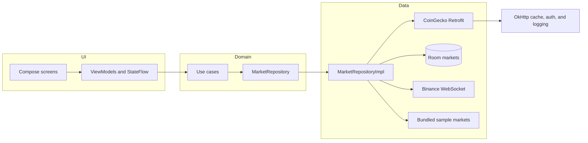

# Pulse

Android market tracker by Arpan Bom. It loads the top coins from the public CoinGecko API, caches them in Room, and overlays live last prices from Binance's public WebSocket for a fixed set of USDT pairs.


## Honest demo note

This is a portfolio demonstration, not a trading product and not financial advice.

- CoinGecko's public markets endpoint and Binance's public mini-ticker stream are free and need no account. Both can rate-limit, lag, or change without notice. Prices can be missing or wrong.
- No CoinGecko key is shipped. If you set `COINGECKO_API_KEY` in `local.properties` (gitignored), the auth interceptor sends it as `x-cg-demo-api-key`. The logging interceptor redacts that header.
- Room is the offline store. OkHttp also keeps a 10 MB HTTP cache and, when the server omits `Cache-Control`, writes `public, max-age=60` on the response. That cache is not the source of truth.
- If a refresh fails and Room is empty, the app inserts **bundled sample markets** and says so on screen. Those prices are rounded placeholders. A live Binance tick can replace a placeholder for a supported USDT pair; anything else stays fake until a real refresh succeeds.
- Live subscriptions are limited to a known Binance USDT allowlist (BTC, ETH, SOL, and other large assets). An unknown symbol is left off the socket so one bad stream name cannot drop the connection. Coins outside that list keep their last REST or sample price.
- The WebSocket reconnects with capped backoff after a socket failure. Leaving the screen cancels the stream.
- Unit tests run on the JVM. There are no instrumented or Espresso tests, and CI does not start an emulator.

## Architecture

MVVM with a clean split: Compose state lives in the UI layer, use cases are the domain API, and Retrofit, Room, and the socket stay behind the repository.



| Layer | Responsibility |
| --- | --- |
| `ui` | Compose, Navigation, `StateFlow` UI state, money formatting |
| `domain` | `MarketCoin`, `LiveQuote`, repository ports, use cases |
| `data` | CoinGecko DTOs, Room, Binance parser and socket, sample fallback |
| `di` | Hilt modules for OkHttp, Retrofit, Room, dispatchers, and bindings |

A refresh failure becomes a `RefreshResult.Failed` with a `MarketError` (`Offline`, `RateLimited`, `Server`, `Unknown`). The markets screen keeps whatever Room already has, shows a banner, and retries from pull-to-refresh or the banner action.

## Stack

- Kotlin, Jetpack Compose, Material 3, Navigation
- MVVM, Hilt, Coroutines, Flow, `StateFlow`
- Retrofit, OkHttp (auth interceptor, HTTP logging, cache, cache-control network interceptor)
- OkHttp WebSocket for `wss://stream.binance.com:9443`
- Room
- Unit tests: JUnit 4, MockK, Turbine, MockWebServer

## Run

Open the project in Android Studio (JDK 17, Android SDK 35) and run the `app` configuration. The first screen is the market list; a row opens the coin detail.

Optional, in `local.properties`:

```properties
COINGECKO_API_KEY=your_demo_key
```

## Tests and CI

GitHub Actions runs, on JDK 17:

```bash
./gradlew lint test assembleDebug
```

That is lint for the app variants, JVM unit tests, and a debug APK. It does not run `connectedAndroidTest`.

Covered on the JVM:

- DTO mapping and timestamp parsing
- Auth header present only when a key is configured
- Cache-Control injection when the server omits it
- Mini-ticker parsing, stream URL shape, reconnect delay, and a MockWebServer WebSocket upgrade
- Repository refresh, HTTP 429/503, malformed JSON, connection failure, sample seeding, and the Binance symbol filter
- Markets and coin detail `StateFlow` behavior, including search and a live price overlay

## Fonts

DM Sans and IBM Plex Mono are included under the SIL Open Font License.
